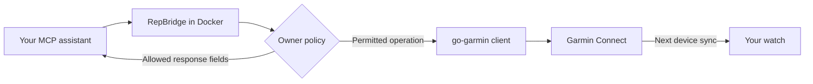

# RepBridge

**A Garmin Connect MCP server with IAM-style permissions and OpenAI gateway setup.**

RepBridge exposes Garmin Connect tools to ChatGPT and other MCP-compatible
assistants. It wraps [`ndeloof/go-garmin`](https://github.com/ndeloof/go-garmin)
with **server-enforced, IAM-style permissions** and Docker-based setup.
The main feature is fine-grained delegation: choose exactly what an assistant
may do, which Garmin data it may receive, and under what conditions.

- **Garmin Connect over MCP:** let an assistant read permitted Garmin data,
  create and edit workouts, schedule them, and queue them for a device.
- **IAM-style permissions:** a local JSON policy controls allowed actions,
  returned fields and conditions such as workout-name prefixes or activity-date
  boundaries. Access is denied by default, and explicit Deny takes precedence.
  This is an IAM-inspired subset, not an AWS IAM implementation.
- **OpenAI gateway setup:** the included Docker Compose service connects the
  MCP server through a OpenAI Secure MCP Tunnel for ChatGPT. You supply
  the tunnel configuration and restricted runtime key, then install the
  integration in ChatGPT. See [ChatGPT setup](#chatgpt-through-an-openai-tunnel).

Run it on your computer or a home server. Local MCP clients can use stdio;
authenticated HTTP and the OpenAI gateway are optional. Garmin sign-in happens in
your browser on Garmin's page, saved tokens are encrypted, and MCP tools cannot
change the owner policy.

**Experimental · one Garmin account per deployment · Apache-2.0**

[Permissions and examples](#permissions) · [Quick start](#quick-start) ·
[Connect an assistant](#connect-an-assistant) · [Operations](#operations) ·
[Contributing](CONTRIBUTING.md) · [Releases](#releases)

## Permissions

**The owner policy is the boundary between an assistant and your Garmin account.**
RepBridge evaluates it on the server for every tool invocation and filters the
response before returning data to the client. The same rules apply to local MCP,
authenticated HTTP and the OpenAI gateway. A model instruction, a guessed tool name,
or a caller-supplied workout name/date cannot override the policy.

You can independently control:

| Control | Policy element | Example |
| --- | --- | --- |
| Which operations may run | `Action` and `Effect` | Allow workout creation; deny deletion |
| Which workouts may be changed | `Condition` with `StringLike` or `StringEquals` | Only names matching `AI: *` |
| Which activity history may be read | `Condition` with date operators | Only activities starting on/after a chosen instant |
| Which response fields the assistant sees | `Fields` using JSON Pointers | Return distance and duration, omit GPS and heart rate |

### How decisions work

1. **Default deny:** an action needs a matching `Allow`. Unclassified tools and
   actions without a grant remain unavailable.
2. **Conditions must match:** the server evaluates supported attributes against
   validated workout input or trusted Garmin metadata. Caller assertions do not
   authorize access.
3. **Explicit Deny wins:** any matching `Deny` blocks the whole action, even when
   another statement allows it. Statement order does not change this.
4. **Response projection:** successful results contain only fields granted by
   matching Allows. Multiple matching Allows combine their fields; a broad
   `Fields: ["*"]` grant can widen disclosure.

These rules are enforced in code. MCP tools cannot edit the policy. Human
approval is an additional responsibility of the MCP client: a policy grant
alone is not proof that a user approved a write.

### Example 1: create and edit only AI-prefixed workouts

This complete policy allows two operations and returns only an ID/name receipt:

```json
{
  "Version": "2026-10-20",
  "Statement": [
    {
      "Sid": "CreateAndEditAIWorkouts",
      "Effect": "Allow",
      "Action": ["garmin:create_workout", "garmin:update_workout"],
      "Resource": "*",
      "Fields": ["/workoutId", "/workoutName"],
      "Condition": {
        "StringLike": {
          "garmin:WorkoutName": ["AI: *"]
        }
      }
    }
  ]
}
```

- `AI: Full body` matches; `Full body`, `ai: Full body` and leading-space
  variants do not. Matching is case sensitive; `*` matches any sequence.
- Creation checks the actual native `workout.workoutName` submitted to Garmin.
- Editing checks **both the fetched existing name and the replacement name**.
  An assistant cannot gain access to an unrelated workout by renaming it into
  the allowed prefix, or remove the prefix from an allowed workout.
- This policy grants no workout reads, calendar scheduling, device delivery,
  activity reads or helper tools. Add those explicitly when needed, or adapt
  the more complete [starter policy](policies/starter.json).

To restrict scheduling or delivery in the same way, the supported actions are
`garmin:schedule_workout` and `garmin:push_workout_to_device`. Both check the
existing workout's name; delivery also verifies that the device belongs to the
account. Their response fields need their own appropriate grant.

### Example 2: recent activity summaries, without GPS or heart rate

This complete read-only policy returns a small selection of summary fields and
sets a hard lower bound on activity history:

```json
{
  "Version": "2026-10-20",
  "Statement": [
    {
      "Sid": "ReadActivitySummaries",
      "Effect": "Allow",
      "Action": ["garmin:list_activities"],
      "Resource": "*",
      "Fields": ["/activityId", "/activityName", "/distance", "/duration"]
    },
    {
      "Sid": "DenyEarlierActivityHistory",
      "Effect": "Deny",
      "Action": ["garmin:list_activities", "garmin:get_activity*"],
      "Resource": "*",
      "Condition": {
        "DateLessThan": {
          "garmin:ActivityStartTime": ["2026-10-15T00:00:00+02:00"]
        }
      }
    }
  ]
}
```

- Starts **at or after** the boundary are eligible. The timestamp is midnight
  in Warsaw on 15 October 2026; comparisons use the actual instant and explicit
  offset, not a date string or the activity's name.
- The server obtains the start time from Garmin UTC metadata. Missing, invalid
  or conflicting metadata fails closed. The caller cannot supply a newer date
  to unlock an old activity.
- Each list item is filtered by date and then projected to the four allowed
  fields. GPS coordinates, heart rate, calories and other unselected fields
  are not returned. Personal information written into an allowed field such
  as `activityName` is still disclosed.
- Detail tools have **no Allow** here. The `garmin:get_activity*` Deny also
  preserves the history boundary if you later grant a classified detail tool.
  Action wildcards cover explicitly classified tools, not arbitrary endpoints.
- Garmin pagination offsets are preserved: a page may become short or empty
  after filtering. No older records are disclosed to explain omissions.

**To narrow an existing policy, replace its broader activity Allow.** Adding
this four-field Allow beside an existing `Fields: ["*"]` Allow does not remove
that broader disclosure. If you deliberately choose `Fields: ["*"]`, you grant
all returned fields for eligible records, including sensitive fields Garmin
returns. The activity-date and workout-name restrictions do not redact those fields.

### Example 3: make workout deletion an explicit prohibition

Add this statement to the `Statement` array of an existing policy:

```json
{
  "Sid": "NeverDeleteWorkouts",
  "Effect": "Deny",
  "Action": ["garmin:delete_workout"],
  "Resource": "*"
}
```

Without an Allow, deletion is already denied by default. This explicit Deny
keeps it blocked even if a later statement grants a wider action pattern.
An Allow cannot override it; the owner must remove the Deny deliberately to
enable deletion. Deny statements block whole actions and do not take `Fields`.
A date-conditioned Deny, as in example 2, applies only when its condition matches.

### Apply and inspect your policy

The quick start loads [`policies/starter.json`](policies/starter.json). It permits
AI-prefixed workout management, scheduling/delivery and minimal device discovery;
activity and health reads are disabled. `policies/default.json` carries the same grants for file-mounted deployments.

The first two examples above are independent complete policies; the third is a
statement to insert into one. They illustrate different grants and are not
instructions to append every example to the starter policy. Retain or add
helper/read grants only when you intend to expose those capabilities.

Edit the selected policy file as the owner, validate it, and restart every MCP
process that uses it:

```sh
docker compose -f compose.quickstart.yaml run --rm repbridge policy check
docker compose -f compose.quickstart.yaml run --rm repbridge policy actions
docker compose -f compose.quickstart.yaml run --rm repbridge policy explain --action garmin:create_workout --workout-name 'AI: Full body'
docker compose -f compose.quickstart.yaml run --rm repbridge policy explain --action garmin:delete_workout
docker compose -f compose.quickstart.yaml restart openai-gateway
```

`policy explain` simulates the **currently mounted policy** without a Garmin
call; hypothetical names/dates do not authorize real MCP operations. Restart
`mcp-http` too if used, and let local stdio clients restart their child
containers. A permitted `get_permissions` call reports the active process policy.
Protect the policy directory from other filesystem tools available to a model:
a process with host write access can act as an operator.

### IAM-inspired scope

RepBridge implements a documented subset inspired by IAM: action patterns,
Allow/Deny precedence, field projection and selected string/date conditions.
It is **not AWS IAM compatible**. `Resource` must currently be `"*"`; there are
no IAM roles, principals, account federation or per-ID ARN rules. One deployment
connects to one Garmin account and shares one owner policy across its delegates.
Supported operators are `StringEquals`, `StringLike`, `DateEquals`,
`DateNotEquals`, `DateLessThan`, `DateLessThanEquals`, `DateGreaterThan` and
`DateGreaterThanEquals`. Keys/operators combine with AND; values within one
condition combine with OR. Workout-name conditions apply only to classified
workout operations; date conditions apply only to classified activity readers.
Unsupported combinations, duplicate JSON keys and unknown syntax reject startup.

`Fields` uses JSON Pointers: `/laps/*/distance` selects distances within an array;
`~1` escapes `/` and `~0` escapes `~` in a key. Selecting a parent grants its entire
subtree, including future children. Binary exports need a whole-file grant and
cannot be filtered inside FIT/GPX/ZIP bytes. Date rules do not constrain unrelated
calendar, wellness or aggregate tools: those need separate grants.

## Full Garmin library coverage

RepBridge covers **all 146 public domain-service methods** of the pinned
`go-garmin` library through **148 classified MCP actions**, including local
helpers. Coverage extends beyond workouts: activities and file transfers,
devices, gear, daily wellness, biometrics, body measurements, nutrition,
women's health, training plans, goals, badges/challenges, courses and golf.

**Supported does not mean permitted.** Only actions allowed by the selected
owner policy are available to an assistant. New sensitive reads have no grant
in the starter policy; new writes are explicitly denied. Existing action
wildcards can cover new classified tools and should be reviewed on upgrades.

Run `policy actions` for the action catalogue and `catalog check` to validate
registered schemas without account access. Arbitrary GraphQL is a
separate privileged write and is denied by default; it cannot inherit the
resource-specific date/name guards. Credential and raw-HTTP plumbing are not
exposed as MCP actions.

## What you can do

Ask your connected assistant:

> Create an `AI: Full body` strength workout with three sets of pull-ups,
> rows and leg press. Keep the rest after the final set. Show me the plan,
> then schedule it for tomorrow and queue it for my watch after I approve.

RepBridge provides the native workout schema and exercise catalogue, so the
assistant can build the payload without a separate JSON conversion format.
Delivery is queued in Garmin Connect: the watch receives it during its next sync.
Compatibility of exercises and workout types still depends on Garmin and your device.

| Capability | Starter policy |
| --- | --- |
| Read workout library | Selected workout fields |
| Create and edit workouts | Names beginning with `AI: ` |
| Add a workout to the calendar | Existing workout name must begin with `AI: ` |
| Queue a workout for a registered device | Same name restriction; device must belong to the account |
| Find the destination device | ID, name, model and primary-training flag only |
| Read activities, health or profile data | Disabled |
| Delete workouts or change activities, courses or HR zones | Disabled |

Your MCP client must request approval for writes. A policy grant enables an
operation; it does not prove user consent. Scheduling and sending are separate
explicit tool calls, not implicit side effects of creating a workout.

## Quick start

**Requirements:** Docker Engine or Docker Desktop with Compose v2 and BuildKit,
and a browser on the same computer. No host Go, Python, Node or Make is required.
Use a trusted checkout or an extracted source release, then run from its root:

```sh
docker compose -f compose.quickstart.yaml run --build --rm --service-ports setup
```

This builds the application, generates a random vault key inside a dedicated
Docker volume, and prints a short-lived sign-in URL. Open that URL in a normal
Chrome window and sign in **on Garmin's page**, including OTP if requested.
Allow third-party cookies for the sign-in flow. The application never asks for
your Garmin password. Browser interaction is required; “one command” does not
bypass sign-in or account consent.

Only run one sign-in container at a time: it uses `127.0.0.1:8787`. If that port
is occupied, stop the earlier login attempt. For a remote Docker host, forward port 8787 to your computer with
`ssh -N -L 8787:127.0.0.1:8787 user@server`, then open the printed URL locally.

The new-install project is named `repbridge`, with separate key and token
volumes. It does not reuse an existing legacy `repbridge-data` vault. **Existing
users and NAS deployments:** keep using your current Compose configuration;
preserve the exact key, volume, Compose project identity and tunnel settings
when upgrading. Renaming a project creates different named volumes.

## Connect an assistant

### Local MCP clients

Add this server to a client that supports stdio MCP. Replace `/path/to/repbridge`
with the absolute checkout path; see the [copyable example](examples/mcp-client.json).

```json
{
  "mcpServers": {
    "repbridge": {
      "command": "docker",
      "args": [
        "compose", "--project-directory", "/path/to/repbridge",
        "-f", "/path/to/repbridge/compose.quickstart.yaml",
        "run", "--rm", "--no-deps", "-T", "mcp"
      ]
    }
  }
}
```

Let the client launch the process. Running it manually waits for MCP requests
on stdin. Do not add a TTY. Configure the client to require approval for writes.
Start with `get_permissions` and `garmin_session_status`, then read your workout
library before creating anything.

### ChatGPT through an OpenAI tunnel

The optional gateway embeds the official OpenAI tunnel client. The Docker host
must stay online. It needs outbound connectivity, a tunnel associated with your
ChatGPT account/workspace, and a restricted runtime key. No inbound port or
running Codex app is required. Account and mobile availability are controlled
by OpenAI; confirm a real tool call on your intended ChatGPT surface.

1. Create a tunnel in OpenAI Platform and associate it only with the intended
   ChatGPT account/workspace. Follow the official
   [Secure MCP Tunnel guide](https://developers.openai.com/api/docs/guides/secure-mcp-tunnels).
2. Create a restricted runtime key with the required tunnel Read and Use access.
   Store it through the hidden Docker terminal prompt:

   ```sh
   docker compose -f compose.quickstart.yaml run --rm -it setup runtime-key
   ```

3. Set `REPBRIDGE_OPENAI_TUNNEL_ID` to your tunnel ID in the shell or a local
   Compose environment file. This ID is configuration; the runtime key belongs
   only in the hidden prompt, never chat, command arguments or an environment file.
4. Check configuration, start the gateway and inspect its connection log:

   ```sh
   docker compose -f compose.quickstart.yaml run --rm openai-gateway gateway check
   docker compose -f compose.quickstart.yaml up -d openai-gateway
   docker compose -f compose.quickstart.yaml logs --tail=30 openai-gateway
   ```

5. Install the custom MCP integration in ChatGPT using that tunnel. Restrict it
   to the owner and require approval for writes. Ask it to call `get_permissions`,
   `garmin_session_status` and `list_workouts`, then repeat on your phone.

`gateway check` is offline and reports `connectionVerified: false`. A successful
poll confirms the transport; a successful ChatGPT tool call confirms the complete
connection. Neither proves a workout has reached a watch.

### Authenticated HTTP

A separate bearer key protects the loopback-only endpoint:

```sh
docker compose -f compose.quickstart.yaml run --rm init-access
docker compose -f compose.quickstart.yaml up -d mcp-http
```

Configure your MCP client's secret store with the generated `/config/mcp.key`
from the key volume. Endpoint: `http://127.0.0.1:8788/mcp`. Keep it on loopback;
public ingress requires HTTPS and an established authorization provider.

## How it works



RepBridge adds browser sign-in, encrypted storage, owner authorization and
transports around [`ndeloof/go-garmin`](https://github.com/ndeloof/go-garmin).
The library supplies Garmin models, exercise identifiers, workout calls and
token refresh. The official MCP SDK supplies the protocol; the official OpenAI
client supplies the optional tunnel. Future upstream methods remain unavailable
until explicitly reviewed and classified.

Runtime containers use UID/GID `65532`, a read-only root filesystem, dropped
capabilities and bounded resources. They have no Docker socket. Development and
release tooling runs in separate Docker services; only release image building
needs Docker administration access.

## Operations

- Tokens use AES-256-GCM in the data volume. The random vault key lives in a
  separate key volume mounted read-only by ordinary MCP containers. Docker and
  host administrators can access both and are trusted.
- Automatic refresh saves rotated Garmin tokens. Check with `auth status`;
  owners can run `auth refresh` or repeat browser sign-in when required. MCP
  refresh is denied by the starter policy. Garmin controls token lifetimes.
- Back up both volumes securely and separately. Stop account operations before
  making a consistent backup; restore the matching vault and key together.
  Run one deployment per session: stale copies can conflict after token rotation.
- Never remove the key/data volumes during upgrades. The legacy encrypted vault
  format identifier is intentionally preserved for existing sessions.
- Allowed Garmin responses reach your MCP/model provider. RepBridge adds no
  analytics; provider data handling is outside its control.
- Writes have no network/5xx retry. A timeout may occur after Garmin committed
  the change: inspect permitted reads before retrying to avoid duplicates.
- Tests use synthetic credentials and offline fixtures. Real Garmin sign-in,
  OTP, ChatGPT availability and watch delivery require operator checks.

This is an experimental single-owner server using unofficial Garmin endpoints.
See [SECURITY.md](SECURITY.md) for reporting and trust assumptions.

## Development

All toolchain commands run through Docker. Make is an optional convenience:

```sh
make build
make fmt
make catalog-check
make test
make vet
make lint
make security
make release-check
```

`make test` runs the race suite without external networking; `make fuzz` runs
short JSON and policy fuzz campaigns. See [CONTRIBUTING.md](CONTRIBUTING.md)
for equivalent Docker commands. Generate the current upstream method/action
inventory on stdout with `docker compose -f compose.dev.yaml run --rm dev go run ./cmd/upstream-audit`.

## Releases

Every merge to protected `main` automatically publishes a release through
[GoReleaser](https://goreleaser.com/), starting at **0.1.0**. CI, fuzzing,
secret/dependency scans, and snapshot image checks must pass before publication.
Release jobs are serialized with a queue; later merges do not cancel pending
releases. GitHub's queue currently holds up to 100 pending runs.

Use a Conventional Commit title for each squash-merged PR:

| Change | Example | Version increase |
| --- | --- | --- |
| Compatible fix | `fix(auth): preserve the rotated session` | Patch |
| Compatible feature | `feat(mcp): expose a classified tool` | Minor |
| Breaking change before 1.0 | `feat!: change the policy schema` | Minor |
| Breaking change from 1.0 onward | `feat!: change the policy schema` | Major |
| Documentation, build, maintenance | `docs: clarify setup` | Patch |

Pinned [SVU](https://github.com/caarlos0/svu) calculates the next SemVer from
commit messages, with a patch increase even for maintenance-only changes.
The immutable Git tag is the version source of truth. There is no version-bump
commit or privileged bypass of main protection. Source builds report `dev`;
published binaries and MCP metadata report the release version.

GoReleaser produces Linux amd64/arm64 archives, source archives, SHA-256
checksums and multi-platform GHCR images. Published images carry SBOM and
provenance; snapshot checks work with classic Docker stores too. Releases and
image tags are immutable: a rerun skips an already published commit. A partial
publication requires reconciliation, not overwriting an existing image or tag.

To validate packaging locally without publication:

```sh
docker compose -f compose.release.yaml run --build --rm release check
docker compose -f compose.release.yaml run --build --rm snapshot release --snapshot --clean --skip=publish
```

Snapshot builds load both architecture images locally and scan them. They need
Docker socket access and perform no registry upload or GitHub release creation.
The `release check` service has neither that socket nor a token. Publishing
credentials exist only in the separate publisher service in GitHub Actions.
A manual workflow dispatch can retry a failed release after reconciliation.

Source archives come from the tagged Git tree. Keep only reviewed public files
tracked. Audit results belong in review discussions, not committed reports.
The changelog for each version is generated in
[GitHub Releases](https://github.com/krzysztof-gre/repbridge/releases).

## License and acknowledgements

[Apache License 2.0](LICENSE). See [NOTICE](NOTICE) and
[third-party notices](THIRD_PARTY_NOTICES.md). RepBridge is independent of Garmin
and OpenAI and grants no rights to their trademarks.
