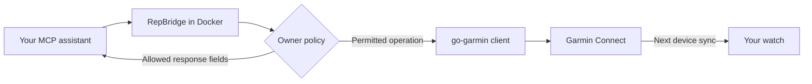

# Operations and recovery

## How it works



RepBridge adds browser sign-in, encrypted storage, owner authorization and
transports around [`ndeloof/go-garmin`](https://github.com/ndeloof/go-garmin).
The library supplies Garmin models, exercise identifiers, workout calls and
token refresh. The official MCP SDK supplies the protocol; the official OpenAI
client supplies the optional tunnel. Future upstream methods remain unavailable
until explicitly reviewed and classified.

Runtime containers use UID/GID `65532`, a read-only root filesystem, dropped
capabilities and bounded resources. They have no Docker socket. Development and
release tooling runs in separate Docker services; only release image building
needs Docker administration access.

## Storage and account operations

- Tokens use AES-256-GCM in the data volume. The random vault key lives in a
  separate key volume mounted read-only by ordinary MCP containers. Docker and
  host administrators can access both and are trusted.
- Automatic refresh saves rotated Garmin tokens. Check with `auth status`;
  owners can run `auth refresh` or repeat browser sign-in when required. MCP
  refresh is denied by the starter policy. Garmin controls token lifetimes.
- Back up both volumes securely and separately. Stop account operations before
  making a consistent backup; restore the matching vault and key together.
  Run one deployment per session: stale copies can conflict after token rotation.
- Never remove the key/data volumes during upgrades. The legacy encrypted vault
  format identifier is intentionally preserved for existing sessions.
- Allowed Garmin responses reach your MCP/model provider. RepBridge adds no
  analytics; provider data handling is outside its control.
- Writes have no network/5xx retry. A timeout may occur after Garmin committed
  the change: inspect permitted reads before retrying to avoid duplicates.
- Tests use synthetic credentials and offline fixtures. Real Garmin sign-in,
  OTP, ChatGPT availability and watch delivery require operator checks.

This is an experimental single-owner server using unofficial Garmin endpoints.
See [SECURITY.md](../SECURITY.md) for reporting and trust assumptions.

### Missing vault key

An existing encrypted vault needs its **original matching 32-byte key**. Restore
that key from a secure backup and preserve the deployment's existing Compose
project, mounts and volume names. A newly generated key cannot decrypt old
credentials. Do not delete volumes or initialize a replacement key as a recovery
step. If no matching backup exists, the stored credentials cannot be recovered;
plan a deliberate fresh sign-in separately.

For a **new installation with no existing vault**, initialize the quick-start
key volume without signing in:

```sh
docker compose -f compose.quickstart.yaml run --build --rm setup init
```

Existing file-mounted deployments must restore their original configured key
file; the quick-start command does not repair or migrate that deployment.
